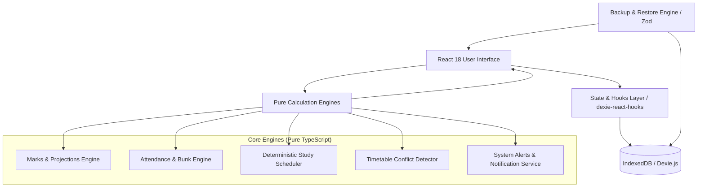

# ScholarSync — Smart Academic Planner & Performance Analyzer

> **A modern, privacy-first, local-first academic productivity platform built for college students (B.Tech CSE Project).**

---

## 1. Executive Summary

**ScholarSync** is an academic planning and performance analytics web application engineered to solve critical pain points faced by undergraduate engineering students:
1. Calculating exact weighted scores across diverse evaluation schemes (Internal exams, Quizzes, Laboratory assessments, Final exams).
2. Simulating required marks in remaining assessments to secure a target GPA or percentage.
3. Managing institutional attendance requirements (e.g. 75% or 80%) with a mathematically rigorous **Bunk Allowance and Recovery Class Calculator**.
4. Generating deterministic, workload-bounded study schedules that respect daily time budgets and existing class commitments without artificial AI gimmicks.
5. Providing weekly lecture clash detection and instant data backup/restore capabilities via IndexedDB.

ScholarSync operates **100% locally in the browser** without paid APIs, mandatory backend servers, or third-party trackers.

---

## 2. Technology Stack & Architectural Decisions

| Layer | Technology | Rationale |
|---|---|---|
| **Frontend Framework** | **React 18 + TypeScript** | Strong type safety across complex mathematical models and reusable UI components. |
| **Bundler & Build Tool** | **Vite** | Instant Hot Module Replacement (HMR) and optimized ES module production builds. |
| **Styling & Design System** | **Tailwind CSS** | Professional design tokens, dark/light theme support, and responsive layouts. |
| **Client-Side Persistence** | **Dexie.js (IndexedDB)** | Structured, transactional client-side storage capable of holding thousands of records with reactive live queries (`dexie-react-hooks`). |
| **Data Visualizations** | **Recharts** | Declarative, SVG-based responsive data charts for marks trends, attendance distributions, and workload analytics. |
| **Date & Time Utilities** | **date-fns** | Modular, lightweight, immutable date calculations. |
| **Form Validation & Schemas** | **Zod + React Hook Form** | Strict schema validation for user input and backup/restore file parsing. |
| **Test Runner & Environment** | **Vitest + React Testing Library + fake-indexeddb** | Unit and integration testing with native Vite configuration. |
| **Icons** | **Lucide React** | Clean, accessible iconography. |

---

## 3. System Architecture



---

## 4. Mathematical Formulations & Engineering Transparency

### A. Weighted Academic Score Engine

Evaluation schemes vary across universities. ScholarSync avoids rigid formulas by allowing fully configurable weights ($W_i$) and maximum marks ($M_i$).

1. **Normalized Percentage per Component:**
   $$\text{Score}_i = \left(\frac{\text{Marks Obtained}_i}{\text{Max Marks}_i}\right) \times 100$$

2. **Component Contribution to Final Grade:**
   $$\text{Contribution}_i = \frac{\text{Score}_i \times W_i}{100}$$

3. **Current Weighted Score Earned:**
   $$\text{Current Weighted Score} = \sum_{i \in \text{Completed}} \text{Contribution}_i$$

4. **Required Weighted Average in Remaining Assessments:**
   $$\text{Required \% in Remaining} = \frac{\text{Target Overall \%} - \text{Points Earned So Far}}{\sum_{j \in \text{Remaining}} W_j} \times 100$$

   *Explicit Cases Handled:*
   - **Target Already Achieved:** If $\text{Points Earned} \ge \text{Target}$, required score is $0\%$.
   - **Target Achievable:** If $0 < \text{Required} \le 100\%$, output required percentage.
   - **Target Requires 100%:** Edge case flagged when required percentage is $\ge 99.99\%$.
   - **Target Mathematically Impossible:** If $\text{Points Earned} + \sum W_j < \text{Target}$, target is impossible. The engine identifies this condition and outputs the **Maximum Achievable Score** rather than an impossible number.

---

### B. Attendance, Bunk Allowance & Recovery Engine

Let $A$ = Attended classes, $T$ = Total classes conducted, and $P$ = Minimum attendance threshold percentage (e.g., $75\%$).

1. **Attendance Percentage:**
   $$\text{Attendance \%} = \begin{cases} \text{null (No data yet)}, & \text{if } T = 0 \\ \left(\frac{A}{T}\right) \times 100, & \text{if } T > 0 \end{cases}$$

2. **Consecutive Classes Required to Recover to Threshold ($x$):**
   $$\frac{A + x}{T + x} \ge \frac{P}{100} \implies x \ge \left\lceil \frac{P \times T - 100 \times A}{100 - P} \right\rceil$$
   *(If $P = 100\%$ and $A < T$, recovery is flagged as mathematically impossible).*

3. **Safe Absences / Bunk Allowance ($y$):**
   $$\frac{A}{T + y} \ge \frac{P}{100} \implies y \le \left\lfloor \frac{100 \times A - P \times T}{P} \right\rfloor$$
   *(If current attendance is below $P\%$, safe bunk count is $0$).*

---

### C. Deterministic Workload Scheduling Algorithm

Instead of relying on non-deterministic or costly AI models, the study planner employs a deterministic scoring heuristic:

$$\text{Task Urgency Score} = S_{\text{deadline}} + S_{\text{priority}} + S_{\text{difficulty}} + S_{\text{exam\_bonus}}$$

- **Deadline Urgency:** Overdue (+100), $\le 2$ days (+80), $\le 3$ days (+50), $\le 7$ days (+25).
- **Priority:** High (+40), Medium (+20), Low (+5).
- **Subject Difficulty:** Subject Difficulty $(1-5) \times 6$.
- **Exam Preparation:** Category bonus (+30).

**Workload Limit Rule:**
$$\sum \text{Allocated Minutes on Day } d \le \text{User Declared Daily Budget}$$

If total remaining workload exceeds declared available capacity across the planning horizon, the engine triggers an **Overload Warning** and defers low-priority tasks while reserving slots for critical deadlines.

### E. Academic Calendar, Holiday Precedence & SSRF Security

The Academic Calendar extension enables ingestion, reconciliation, and automated schedule adjustment across institutional notices and student-customized routines:

1. **Multi-Format Extraction:**
   - **Spreadsheet/CSV:** Parsed directly client-side via `xlsx` (SheetJS) with automated column header detection for event dates, titles, and categories.
   - **Plain Text & PDF Streams:** Text is extracted from PDF bytecode streams without external paid cloud APIs, supporting ISO, Indian/UK (`DD/MM/YYYY`), US (`MM/DD/YYYY`), ordinals (`15th August`), and date ranges (`10/10/2024 to 15/10/2024`).
   - **Interactive Preview Screen:** Ingested entries are never committed blindly. Users review an interactive diagnostic table displaying confidence scores, duplicate status, and conflict warnings with full editability before database persistence.

2. **Precedence Hierarchy for Conflict Resolution:**
   To guarantee that automated synchronization never destroys student customizations, updates adhere to a deterministic priority chain:
   $$\text{User Manual Override} \succ \text{Confirmed Newer Official College Notice} \succ \text{Previously Imported Calendar} \succ \text{Generated Study Plan}$$

   - When a college website update proposes a new date for an event that has an active user manual override (`isUserOverride: true`), the engine flags a conflict, retains the student's override, and prompts for explicit review.
   - Rescheduled exams automatically boost task priority by $+45$ points in the study planner.
   - Official holidays and unexpected campus closures automatically block study sessions on those calendar dates while preserving completed historical records.

3. **SSRF Defense Policy for College Portal URLs:**
   Direct client/server fetch calls to untrusted user URLs are strictly gated through a defense-in-depth sanitization barrier:
   - Enforces `http://` or `https://` only (blocks `ftp://`, `file:///`, `javascript:`).
   - Rejects loopback addresses (`localhost`, `127.0.0.1`, `::1`).
   - Blocks private RFC 1918 subnets (`10.0.0.0/8`, `172.16.0.0/12`, `192.168.0.0/16`, `0.0.0.0`).
   - Blocks cloud metadata endpoints (`169.254.169.254`, `metadata.google`).

---

## 5. Local Database Schema (Dexie IndexedDB)

Database Name: `ScholarSyncDatabase` (Version 2)

| Store Name | Primary Key | Secondary Indexes | Description |
|---|---|---|---|
| `subjects` | `id` | `semester, academicYear, isArchived, name, createdAt` | Course definitions, credit weights, and evaluation components |
| `attendanceRecords` | `id` | `subjectId, date, status, createdAt` | Session-by-session attendance logs |
| `tasks` | `id` | `subjectId, dueDate, priority, status, createdAt` | Academic assignments, quizzes, and deadlines |
| `timetableSessions` | `id` | `subjectId, dayOfWeek` | Recurring weekly class lecture and laboratory schedule |
| `studyPlans` | `id` | `subjectId, date, isCompleted, createdAt` | Scheduled revision slots |
| `userSettings` | `id` | — | User preferences, active semester, and calculation baselines |
| `notifications` | `id` | `isRead, createdAt` | Active in-app deadline and attendance alerts |
| `academicEvents` *(v2)* | `id` | `startDate, endDate, eventType, sourceType, isUserOverride` | Academic calendar dates, holidays, exams, and closures |
| `calendarSources` *(v2)* | `id` | `sourceType, syncStatus` | Tracked institutional websites and uploaded calendar files |
| `calendarImports` *(v2)* | `id` | `importedAt, filename` | Calendar file upload audit history |
| `scheduleChangeLogs` *(v2)* | `id` | `eventId, changedAt` | Modification history enabling 1-click Undo |

---

## 6. Project Directory Structure

```
c:\Users\angad\Downloads\PROJECTS CSE CORE\
├── index.html                   # HTML5 Entry Point with typography & metadata
├── package.json                 # Dependencies and npm scripts
├── tsconfig.json                # TypeScript strict configuration
├── vite.config.ts               # Vite & Vitest configuration
├── tailwind.config.js           # Tailwind theme & color tokens
├── postcss.config.js            # PostCSS Autoprefixer plugin
├── src/
│   ├── main.tsx                 # React entry point
│   ├── App.tsx                  # Root application coordinator & reactive state
│   ├── index.css                # Tailwind directives & custom utilities
│   ├── types/
│   │   ├── index.ts             # Core TypeScript models & re-exports
│   │   └── calendar.ts          # Academic event, source, diff & audit types
│   ├── lib/
│   │   ├── utils.ts             # Tailwind merge, date formatters, color palette
│   │   ├── marksCalculator.ts   # Pure weighted score & required marks engine
│   │   ├── attendanceCalculator.ts # Pure attendance & bunk allowance calculator
│   │   ├── studyPlanner.ts      # Workload scheduler with calendar holiday blocking
│   │   ├── timetableConflict.ts # Schedule overlap & clash detector
│   │   ├── calendarParser.ts    # Multi-format Excel, CSV, text & PDF stream parser
│   │   ├── collegeWebsiteIntegration.ts # SSRF-safe URL validation & precedence diff engine
│   │   └── notificationService.ts # In-app alert generator & Web Notification API
│   ├── db/
│   │   ├── index.ts             # Dexie IndexedDB instance & v1 -> v2 schema migrations
│   │   ├── hooks.ts             # Reactive live query hooks (events, tasks, subjects)
│   │   ├── demoData.ts          # Realistic B.Tech CSE sample dataset
│   │   └── backupRestore.ts     # Zod-validated JSON v1/v2 import/export & CSV reports
│   ├── components/
│   │   ├── common/              # Button, Card, Badge, Modal, Input, Select, Alert, Toast
│   │   ├── layout/              # Sidebar, Header, MobileNav with Calendar tab
│   │   ├── dashboard/           # KPI cards, today's schedule, calendar alert widgets
│   │   ├── calendar/            # Academic Calendar View, Upload Modal, Holidays Modal, Website Sync Modal
│   │   ├── subjects/            # Subject list, Subject modal, assessment scheme builder
│   │   ├── marks/               # Marks calculator, target simulator, math proof audit
│   │   ├── attendance/          # Bunk calculator, quick mark buttons, history table
│   │   ├── tasks/               # Task manager, subtasks checklist, filter pills
│   │   ├── studyPlanner/        # Workload bounds slider, available days, session plan
│   │   ├── timetable/           # Weekly column grid with conflict badges & slot modal
│   │   ├── analytics/           # Recharts visual trends & workload distributions
│   │   ├── settings/            # JSON import/export, CSV reports, theme & reset
│   │   └── onboarding/          # First-launch setup wizard
│   └── test/
│       └── setup.ts             # Vitest test setup with fake-indexeddb
└── tests/
    ├── marksCalculator.test.ts          # Marks engine unit tests (8 tests)
    ├── attendanceCalculator.test.ts     # Attendance & bunk calculator unit tests (7 tests)
    ├── timetableAndStudyPlanner.test.ts # Timetable clash & scheduler unit tests (5 tests)
    ├── backupRestoreAndSchema.test.ts   # JSON backup & CSV export unit tests (3 tests)
    └── academicCalendarExtension.test.ts # Calendar parser, SSRF, diff & holiday tests (15 tests)
```

---

## 7. How to Install, Run & Test

### Prerequisites
- Node.js LTS (v18.x or v20.x+)
- npm (v9.x or v10.x+)

### 1. Installation
In the project root:
```bash
npm install
```

### 2. Start Development Server
```bash
npm run dev
```
Open `http://localhost:5173` in your browser.

### 3. Run Automated Tests
```bash
npm test
```
All **38 unit and integration tests** in `tests/` will execute and report test passes with zero failures.

### 4. Build for Production
```bash
npm run build
```
Creates an optimized production bundle inside the `dist/` directory ready for static hosting.

---

## 8. College Viva Demonstration Guide

When presenting ScholarSync to an evaluator or college professor, follow this structured 5-minute walkthrough:

### Step 1: First-Time Onboarding & Empty State
- Start with a clean browser session. Show the **Onboarding Wizard** configuring Semester 5 and target marks.
- Highlight the **Empty-State Dashboard** demonstrating that no hardcoded data is shown.

### Step 2: Instant Demo Data Loading
- Click **"Load Demo Data"**.
- Explain that the dataset loads 4 standard B.Tech CSE subjects:
  1. *Design & Analysis of Algorithms (CS501)*
  2. *Operating Systems (CS502)*
  3. *Database Management Systems (CS503)*
  4. *Computer Networks (CS504)*
- Point out the **"Demo Mode Active"** badge and show that demo records use safe prefixes (`demo-`) that can be removed anytime without affecting real user entries.

### Step 3: Demonstrate Accurate Marks Calculation & Mathematical Proof
- Navigate to **Marks Calculator**.
- Select *Operating Systems*.
- Show the table distinguishing between **Raw Marks**, **Max Marks**, **Normalized %**, and **Weight %**.
- Enter or adjust a mark. Show how the **Contribution** and **Current Weighted Score** immediately recompute.
- Change the target score to 95%. Show how the calculator detects that the target is **Mathematically Impossible** and displays the true **Max Achievable Score** rather than a misleading percentage.
- Open the **Calculation Transparency & Mathematical Proof** card to show the formula audit trail.

### Step 4: Demonstrate Attendance & Bunk Allowance Calculator
- Navigate to **Attendance**.
- Select *Computer Networks* (currently at 66.7%).
- Point out the **Recovery Alert**: explains the exact consecutive classes the student must attend to reach 75%.
- Switch to *Database Management Systems* (90.9%).
- Show the **Safe Absences (Bunks)** counter: shows that the student can safely miss up to 3 more classes without dropping below the 75% threshold.
- Click **"Mark Present"** to demonstrate 1-click real-time database update.

### Step 5: Timetable Conflict Detection & Study Planner
- Navigate to **Weekly Timetable**.
- Show the schedule grid. Demonstrate adding an overlapping class slot on Tuesday at 10:15 — observe the red **"Time Clash!"** alert appear automatically.
- Navigate to **Study Planner**.
- Adjust the **Daily Study Budget** slider.
- Click **"Generate / Rebalance Plan"**. Show how sessions are prioritized by upcoming exam dates and subject difficulty while strictly capping hours per day.

### Step 6: Academic Calendar, Custom Holidays & College Website Integration
- Navigate to **Academic Calendar**.
- Show the interactive **Month Grid** and **Agenda List View** displaying institution holidays and examination windows.
- Click **"Import Calendar"**: show the multi-format upload dialog accepting `.xlsx`, `.xls`, `.csv`, and `.pdf` files, followed by the **Interactive Review Screen** with confidence scores, duplicate status badges, and inline editing.
- Click **"Manage Holidays & Changes"**: add an unexpected college closure or postponed exam. Demonstrate the **Change History Log** and the 1-click **Undo** button.
- Click **"Sync College Website"**: input a URL and show SSRF security validation (blocking localhost, private IP subnets, and cloud metadata). Demonstrate the **Diff Preview** showing how user manual overrides are safely preserved against website overwrites.
- Show how adding a holiday automatically updates the **Study Planner** by clearing study sessions on that day without deleting student progress.

### Step 7: Backup, Export & Privacy
- Navigate to **Settings & Backup**.
- Click **"Export Full Backup (JSON)"** to show the complete database exported into structured JSON (Schema Version 2).
- Click **"Attendance Log CSV"** and **"Academic Calendar CSV"** to demonstrate instant export to Microsoft Excel.
- Explain that ScholarSync is **100% local-first**: all records reside in IndexedDB and zero student data is transmitted externally.

---

## 9. Known Limitations & Future Enhancements

| Feature | Current State | Planned Future Enhancement |
|---|---|---|
| **Data Sync** | Local-First via IndexedDB & JSON backup files | End-to-end encrypted peer-to-peer sync (CRDTs or WebRTC) |
| **Notifications** | In-app notification center + Web Notification API | Optional Push API integration with service worker background delivery |
| **Calendar Sync** | In-app timetable & study planner | Native `.ics` export or Google Calendar OAuth integration |
| **Institution Schemes** | Configurable weights, components & thresholds | University grading presets (e.g. VTU, AKTU, Anna University, Mumbai University) |

---

## 10. License

ScholarSync is developed as open-source software under the **MIT License**.
